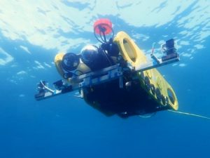

 
 

<h1 align="center"> Marine Robotics Team (RSM) </h1>

   &nbsp;
  

The Marine Robotics Team (RSM) develops tools and methods for both ROVs (Remotely Operated Vehicles) and AUVs (Autonomous Underwater Vehicles). Applications include marine biology, underwater archaeology, and offshore wind farm inspection. For more information, please contact us.
 
🌐 [Visit our website](https://www.lirmm.fr/equipes/rsm/)

**RSM-LIRMM**  
🇫🇷 In French: *équipe **R**obotique **S**ous-**M**arine - 
**L**aboratoire d’**I**nformatique, de **R**obotique et de **M**icroélectronique de **M**ontpellier*  
🇬🇧 In English: Marine Robotics Team - Laboratory of Computer Science, Robotics and Microelectronics of Montpellier

